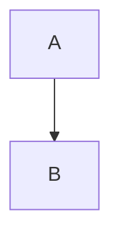

# Architecture

Astro is configured for static output in `astro.config.mjs`, with `src/` as the source directory and `dist/` as the output directory. `public/` is Astro's public directory: its assets are served during development and copied verbatim into `dist/` by Astro. `astro-tools/source-assets.mjs` serves the `content/` compatibility files in development and, during `astro:build:done`, copies compatibility modules, the `content/` compatibility tree, and the root `.nojekyll` file.

## Content and routes

`src/content.config.ts` defines `posts`, `writeups`, and `events` collections using Astro glob loaders. `src/lib/article-data.ts` combines collection entries with authored ordering indexes to generate deterministic article and writeup routes.

```text
content/*.md + JSON
        ↓
content-sync indexes and validation
        ↓
Astro collections + ordered article data
        ↓
src/pages/generated/* routes
        ↓
ArticleShell / QuestShell + static HTML
```

The content API endpoints under `src/pages/content/` preserve compatibility URLs for raw Markdown and JSON metadata. `src/pages/astro-article-order.json.ts` exposes Astro's ordered route metadata. `src/pages/sitemap.xml.ts` generates `/sitemap.xml` from the same ordered collections.

## Markdown

`src/lib/markdown-converter/` extracts YAML frontmatter with `js-yaml`, protects math before Markdown block detection, converts supported Markdown structures, and restores math tokens. `src/lib/markdown.ts` provides the compatibility API used by article pages and delegates to `convertMarkdown()`.

Math runs in the browser through the existing MathJax/typesetting behavior. Pipes inside math are protected from table parsing and remain unchanged.

## Browser behavior

Astro renders shells and article pages at build time. Browser JavaScript in `public/assets/js/` handles navigation, read-model projections, search/filtering, pagination, theme state, music state, and fallback navigation. Query parameters drive blog, CTF, archive/search, event, topic, category, and page views. `astro-pages.js` and `astro-navigation.js` are the current navigation controllers; `astro-controls.js` handles controls.

Compatibility modules remain available under `/legacy/assets/js/` from `compat/legacy-assets/js/`, but no current page dynamically loads them. Generated article routes and the shared content viewer are the only active content renderers.

## Mermaid diagram viewer

Mermaid diagrams are authored as ordinary fenced blocks in Markdown:

````markdown

````

`src/lib/content-view.ts` deliberately leaves `mermaid` fences unhighlighted, so the built HTML contains `<pre><code data-language="mermaid">` with the escaped source. That block is the no-JavaScript fallback and is never removed from the DOM.

`src/scripts/mermaid-viewer.js` is the bundled viewer (included by `ArticleShell.astro` through the `mermaid` prop on `QuestShell`). It dynamically imports the pinned `mermaid` package (`package.json`, currently 12.3.0), so Mermaid's chunks are fetched only on pages that contain a diagram. It initializes Mermaid once per document, renders each block through `mermaid.render()`, keeps the source `<pre>` available, and inserts one `<figure class="diagram">` with a toolbar (source, copy, expand).

Theme colors are read from the live CSS tokens (`--panel`, `--text`, `--muted`, `--accent-*`, `--font-code`) and injected as `themeVariables` on Mermaid's `base` theme. `radiantblaze:themechange` re-initializes and re-renders the existing figures without duplicating them; `radiantblaze:contentchange` renders diagrams after SPA navigation through a window singleton. Diagram labels use the normal-width mono stack rather than the condensed November face for legibility. `securityLevel` stays `strict`.

On a parse error, empty block, or module load failure, the source stays visible and a `.diagram-error` note explains the fallback; developer details go to the console. `npm run check:mermaid` drives a local Chrome over CDP and covers rendering, offline behavior, missing modules, source fallback, copy, the expanded dialog, theme switching, SPA navigation, fonts, and four viewport widths. Diagrams stay inside the article column: the 248px sidebar rail's height depends on the expandable TOC, so a CSS-only breakout would overlap the TOC/music card; keeping the frame in-column avoids that instability. Wide diagrams scroll horizontally inside `.diagram__stage`, and the SVG's intrinsic width is recorded as `--diagram-min-width` so phones scroll instead of shrinking labels below legibility.

The 404 page is `src/pages/404.astro`. Public `/generated/...` paths are Astro routes, not generated filesystem HTML.
