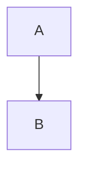

# Architecture

Astro is configured for static output in `astro.config.mjs`, with `src/` as the source directory and `dist/` as the output directory. `public/` is Astro's public directory: its assets are served during development and copied verbatim into `dist/` by Astro. `astro-tools/source-assets.mjs` serves the `content/` compatibility files in development and, during `astro:build:done`, copies compatibility modules, the `content/` compatibility tree, and the root `.nojekyll` file.

## Content and routes

`src/content.config.ts` defines `posts`, `writeups`, and `events` collections using Astro glob loaders. `src/lib/article-data.ts` combines collection entries with authored ordering indexes to generate deterministic article and writeup routes.

```text
content/*.md + JSON
        ↓
content-sync indexes and validation
        ↓
Astro collections + ordered article data
        ↓
src/pages/generated/* routes
        ↓
ArticleShell / QuestShell + static HTML
```

The content API endpoints under `src/pages/content/` preserve compatibility URLs for raw Markdown and JSON metadata. `src/pages/astro-article-order.json.ts` exposes Astro's ordered route metadata. `src/pages/sitemap.xml.ts` generates `/sitemap.xml` from the same ordered collections.

## Markdown

`src/lib/markdown-converter/` extracts YAML frontmatter with `js-yaml`, protects math before Markdown block detection, converts supported Markdown structures, and restores math tokens. `src/lib/markdown.ts` provides the compatibility API used by article pages and delegates to `convertMarkdown()`.

Math runs in the browser through the existing MathJax/typesetting behavior. Pipes inside math are protected from table parsing and remain unchanged.

## CSS architecture

The stylesheet is authored under `src/styles/`. `src/styles/style.css` is the only entry point and imports modules in their original cascade order; Astro/Vite bundles them into one hashed CSS asset in `dist/_astro/`, so production still loads a single stylesheet. Modules are grouped by ownership: `base/` (fonts, variables, reset, theme, typography), `layout/` (header, quest header, footer), `components/` (music, listing, panels, content shell, Mermaid), `pages/` (home, portfolio, article, CTF, 404, writeup), and `utilities/` (reduced motion, final refinements). Page-specific rules stay in their page modules rather than being pushed into Astro components; the standalone post/writeup redirect shells keep their small inline styles because they are independent documents. Add new rules to the owning module; keep the import order in `style.css` stable unless a deliberate cascade change is verified.

## Browser behavior

Astro renders shells and article pages at build time. Browser JavaScript is split between bundled TypeScript modules in `src/scripts/` and unbundled public modules in `public/assets/js/`. Bundled modules own the shell controls, the initial page bootstrap, SPA navigation, and the `portfolio`/`legacy-redirect` page modules; public modules own article rendering, listing/search surfaces, read-model projections, the query model, and music state. Query parameters drive blog, CTF, archive/search, event, topic, category, and page views.

Page modules render inside `<main>`. `astro-navigation.ts` imports each module once and calls `initPage({ fromSpa: true })` when the bundle preserves that export; side-effect-only entries (`portfolio.ts`, `mermaid-viewer.js`) self-initialize and listen for `radiantblaze:contentchange`. It resolves public module URLs through `ASSET_VERSION`. It dispatches `radiantblaze:pagedisposing` before the swap so observers, listeners, and DOM references from the previous page are released. The router also reconciles the fetched document's canonical, description, Open Graph, and Twitter metadata into `<head>` without replacing scripts or styles. Do not reintroduce cache-busting module imports or module-scope DOM queries: both retained the replaced page for the rest of the session.

Project records are published under `/portfolio/projects/{slug}.html`; cards and the homepage selected-work section use `portfolio-data.ts` for the same slug/route derivation. Writeup pages receive a build-time related-challenge list from `related-content.ts`, which ranks shared tags, category, and event and omits unrelated entries. Search adds active-filter chips, type counts, safe term highlighting, and a reset action while preserving the existing query/topic/year/type URL parameters.

Listing pagination is bounded by `pageWindow()` in `list-utils.js`: large archives show the first/last page and a small window around the current page instead of one control per page. CTF event posters use animated SMIL SVGs only while visible; `astro-pages.js` swaps to the static twins under `/assets/ctf-animations/static/` when a card leaves the viewport or the visitor prefers reduced motion. The reading-progress bar and music equalizer update via transforms so scrolling and playback stay off the layout path. `npm run check:spa` covers these lifecycle, conditional-loading, single-instance, reduced-motion, and offscreen-pause contracts.

Compatibility modules remain available under `/legacy/assets/js/` from `compat/legacy-assets/js/`, but no current page dynamically loads them. Generated article routes and the shared content viewer are the only active content renderers.

## Mermaid diagram viewer

Mermaid diagrams are authored as ordinary fenced blocks in Markdown:

````markdown

````

`src/lib/content-view.ts` deliberately leaves `mermaid` fences unhighlighted, so the built HTML contains `<pre><code data-language="mermaid">` with the escaped source. That block is the no-JavaScript fallback and is never removed from the DOM.

`src/scripts/mermaid-viewer.js` is the bundled viewer. `ArticleShell.astro` receives a `mermaid` flag from the post/writeup routes (set only when the rendered body contains a Mermaid block) and passes it to `QuestShell`, so the viewer module itself is not loaded on articles without diagrams. It dynamically imports the pinned `mermaid` package (`package.json`, currently 12.3.0), so Mermaid's chunks are fetched only after a diagram is found. The viewer keeps Mermaid's default ELK flowchart layout, preserving the previously verified ELK rendering path; individual diagrams may request dagre explicitly with a Mermaid init directive. It initializes Mermaid once per document, renders each block through `mermaid.render()`, keeps the source `<pre>` available, and inserts one `<figure class="diagram">` with a toolbar (source, copy, expand).

Theme colors are read from the live CSS tokens (`--panel`, `--text`, `--muted`, `--accent-*`, `--font-code`) and injected as `themeVariables` on Mermaid's `base` theme. `radiantblaze:themechange` re-initializes and re-renders the existing figures without duplicating them; `radiantblaze:contentchange` renders diagrams after SPA navigation through a window singleton. Diagram labels use the normal-width mono stack rather than the condensed November face for legibility. `securityLevel` stays `strict`.

On a parse error, empty block, or module load failure, the source stays visible and a `.diagram-error` note explains the fallback; developer details go to the console. `npm run check:mermaid` drives a local Chrome over CDP and covers rendering, default ELK and explicit dagre layouts, offline behavior, missing modules, source fallback, copy, the expanded dialog, theme switching, SPA navigation, fonts, and four viewport widths. Diagrams stay inside the article column: the 248px sidebar rail's height depends on the expandable TOC, so a CSS-only breakout would overlap the TOC/music card; keeping the frame in-column avoids that instability. Wide diagrams scroll horizontally inside `.diagram__stage`, and the SVG's intrinsic width is recorded as `--diagram-min-width` so phones scroll instead of shrinking labels below legibility.

## Browser JavaScript assets

Browser JavaScript is split into two deliberately different pipelines:

- **Bundled shell and page modules** live in `src/scripts/` as TypeScript and are imported by Astro components, so Vite bundles them and emits content-hashed files under `dist/_astro/`. `astro-controls.ts` (shell controls), `page-loader.ts` (initial page bootstrap), `astro-navigation.ts` (SPA navigation), plus the page-owned `portfolio.ts` and `legacy-redirect.ts` belong here. These modules must not carry `?v=` query strings on their `<script>` tags: the hashed filename is the cache key, and SPA page discovery relies on a real `src` (Vite's `assetsInlineLimit` keeps small entries out of the HTML).
- **Public legacy-bound modules** stay in `public/assets/js/` unbundled and untyped, because they are fetched as stable public or versioned URLs rather than imported through Vite: `astro-article.js`, `astro-pages.js`, `astro-runtime.js`, `astro-query-model.js`, and `music-controller.js`. Reference them with `ASSET_VERSION` from `src/lib/assets.ts` (`?v=...`) so a deploy invalidates cached copies.
- **Frozen compatibility artifacts**: `public/assets/js/list-utils.js` and `public/assets/js/markdown-renderer.js` are protected. They are copied byte-for-byte into `dist/legacy/assets/js/`, their SHA-256 digests are pinned in `astro-tools/test-compatibility-assets.mjs`, and `.prettierignore` keeps formatters from rewriting them. Never bundle, convert, or reformat them without an explicit compatibility migration.

Page modules are rendered inside `<main>`; the page bootstrap queries only the newly inserted `<main>` so a swapped-in page cannot resurrect the previous page's modules.

Static asset cache-busting versions come from `src/lib/assets.ts`; use `ASSET_VERSION` only for unbundled public `<script>`/`<link>` tags instead of hardcoding a date. Bundled modules omit the query string entirely.

The 404 page is `src/pages/404.astro`. Public `/generated/...` paths are Astro routes, not generated filesystem HTML.
