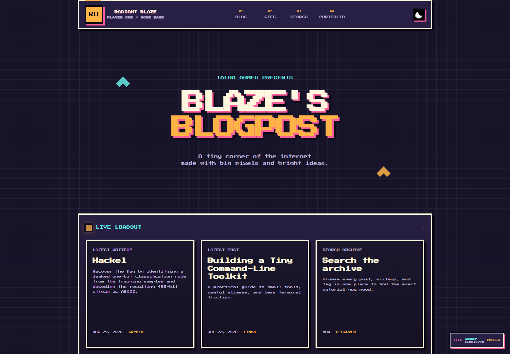
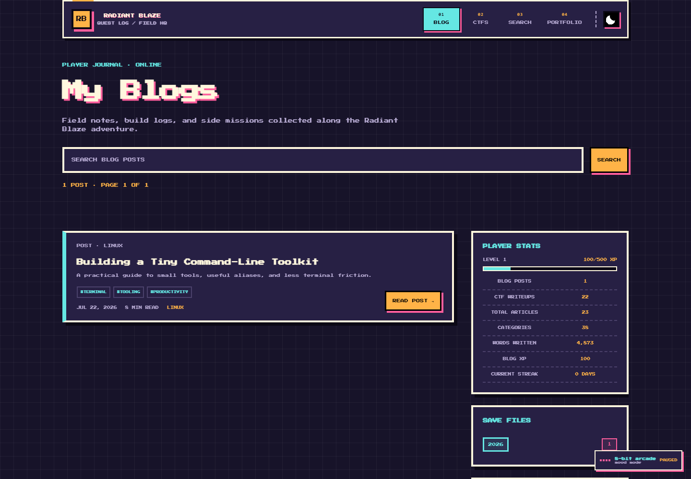
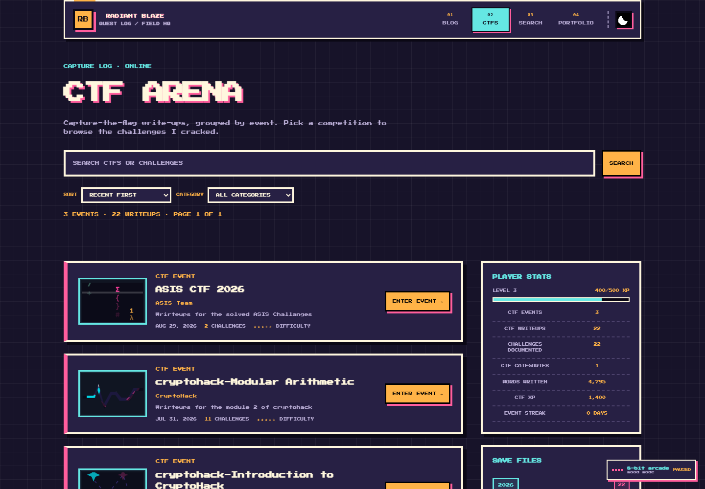
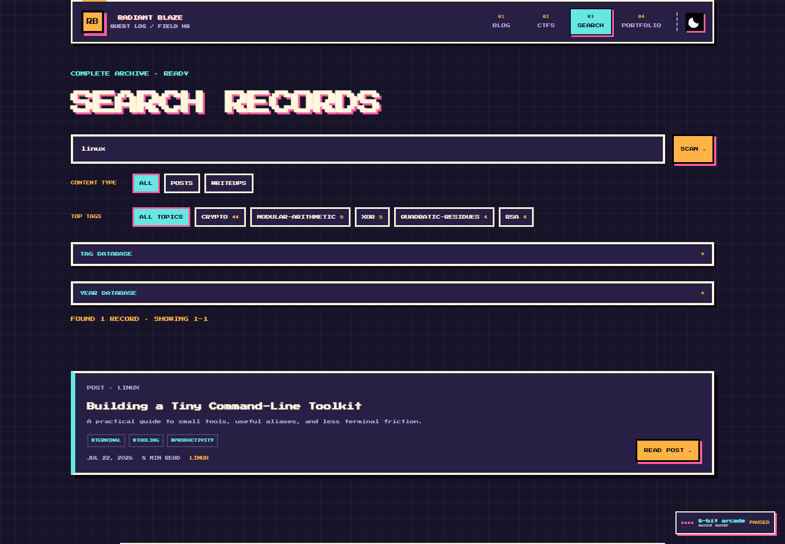

<div align="center">
  
</div>

<h1 align="center">Radiant Blaze</h1>

<p align="center">
  A personal digital space for software experiments, Linux notes, cybersecurity learning, and CTF writeups.
</p>

<p align="center">
  <a href="https://radiant-blaze.github.io/">Visit the website</a>
  ·
  <a href="https://github.com/Radiant-Blaze/radiant-blaze.github.io">View the repository</a>
</p>

---

## About

Radiant Blaze is Talha Ahmed's personal developer and cybersecurity site. It combines a portfolio with field notes, technical articles, searchable CTF writeups, and a small shared visual system inspired by retro games and neon cityscapes.

The content is owned in Markdown and JSON, while Astro turns the repository into a static website suitable for GitHub Pages.

## Explore

| Portfolio | Blogs & articles | CTF writeups | Search |
|:---:|:---:|:---:|:---:|
| [About and projects](https://radiant-blaze.github.io/portfolio/) | [My blogs](https://radiant-blaze.github.io/pages/blog.html) | [CTF archive](https://radiant-blaze.github.io/pages/ctf.html) | [Search records](https://radiant-blaze.github.io/pages/search.html) |

<table>
  <tr>
    <td width="50%" valign="top">
      <a href="https://radiant-blaze.github.io/">
        
      </a>
    </td>
    <td width="50%" valign="top">
      <a href="https://radiant-blaze.github.io/pages/blog.html">
        
      </a>
    </td>
  </tr>
  <tr>
    <td width="50%" valign="top">
      <a href="https://radiant-blaze.github.io/pages/ctf.html">
        
      </a>
    </td>
    <td width="50%" valign="top">
      <a href="https://radiant-blaze.github.io/pages/search.html">
        
      </a>
    </td>
  </tr>
</table>

## Features

- **Dynamic content archives** - posts and CTF writeups are authored in Markdown and combined with ordered JSON indexes.
- **Portfolio sections** - projects, skills, achievements, research, certifications, profile copy, and configurable custom sections are maintained through Markdown and `content/portfolio/config.json`.
- **Archive search** - search across authored content, with content-type and year filters and paginated results.
- **CTF year and category filtering** - the writeup archive includes sorting, category filters, year search, and pagination.
- **Player-facing stats** - blog, CTF, category, word-count, XP, and streak information is derived from published content.
- **Theme control** - the interface includes a persistent light/dark theme switch.
- **Contextual music player** - playlists change for the homepage, archive listings, and article-reading contexts, with metadata-driven track names and artists.
- **Static deployment** - Astro builds the complete site and sitemap into `dist/` for GitHub Pages.

## Tech Stack

<p>
  
  
  
  
  
</p>

- **Astro 7** - static routes, layouts, generated article pages, and the sitemap.
- **TypeScript and JavaScript** - Astro components, content projection, page behavior, and build tooling.
- **CSS** - the retro-inspired dark and light visual themes.
- **Markdown + YAML frontmatter** - the primary authoring format for posts, writeups, and portfolio entries.
- **js-yaml** - frontmatter parsing and YAML support.
- **GitHub Actions + GitHub Pages** - automated production deployment.

## Project Structure

```text
.
├── .github/workflows/deploy.yml   # GitHub Pages build and deploy workflow
├── assets/
│   ├── fonts/                     # Pixel font assets
│   └── music/                     # Audio playlists and track metadata
├── astro-tools/                   # Content synchronization and project checks
├── content/
│   ├── posts/                     # Markdown blog posts and ordering indexes
│   ├── ctfs/                      # CTF event metadata and Markdown writeups
│   ├── portfolio/                 # Portfolio configuration and Markdown entries
│   └── site.json                  # Shared site metadata
├── public/
│   └── images/readme/             # README banner and website previews
├── src/
│   ├── layouts/                   # Shared article and archive shells
│   ├── lib/                       # Content projection and Markdown tooling
│   ├── pages/                     # Astro routes and generated content endpoints
│   └── content.config.ts          # Astro content collection schemas
├── astro.config.mjs               # Static build configuration
└── package.json                   # Development and validation commands
```

## Getting Started

### Prerequisites

- A current Node.js installation.
- npm, included with Node.js.

The GitHub Actions workflow uses Node.js 26. Check Node compatibility for your local environment before installing dependencies.

### Install

```sh
npm ci
```

### Local development

```sh
npm run dev
```

Astro starts the development server locally. Some legacy `.html` URLs may require a production preview for route parity; the repository documentation recommends using the built site to inspect those routes.

### Production build

```sh
npm run build
npm run preview
```

The build writes the static output to `dist/`.

### Verified repository commands

```sh
npm run content:sync
npm run content:check
npm run test:renderer
npm run test:converter
npm run test:real-content
npm run check:blog-projection
npm run check:search-projection
npm run check:ctf-projection
npm run test:year-search
npm run test:portfolio
```

Additional parity, compatibility, and Astro route checks are also defined in `package.json`.

## Content Management

### Blog posts

Place a post under `content/posts/<category>/`. Run the content synchronizer when adding or removing posts so the ordered index stays current.

```sh
npm run content:sync
```

The frontmatter used by the current post format includes a title, description, date, tags, category, and presentation metadata:

```markdown
---
title: Building a Tiny Command-Line Toolkit
description: A practical guide to small tools, useful aliases, and less terminal friction.
date: 2026-07-22
tags: [terminal, tooling, productivity]
category: Linux
difficulty: 3
xp: 450
thumbnail: /assets/quests/021-toolkit.png
estimatedPlayTime: 8 min
author: Radiant Blaze
path: /pages/post.html
---
```

Then add the article body beneath the frontmatter. Post ordering is maintained in `content/posts/index.json`.

### CTF writeups

Add challenge Markdown files to an existing event folder under `content/ctfs/<event>/`, or create a new event folder with a `ctf.json` metadata file:

```json
{
  "title": "ASIS CTF 2026",
  "event": "ASIS Team",
  "date": "2026-08-29",
  "difficulty": 3,
  "url": "https://asisctf.com/",
  "description": "Writeups for the solved ASIS challenges",
  "challenges": [
    "Hackel.md",
    "Headache.md"
  ]
}
```

Writeup frontmatter follows this documented shape:

```markdown
---
title: Hackel
category: Crypto
points: 24
difficulty: 3
tags: [crypto, group-theory, classification]
author: Radiant Blaze
description: Recover the flag from the challenge samples.
---
```

Run `npm run content:sync` after changing challenge files or event contents, and `npm run content:check` to verify that generated indexes are synchronized.

### Portfolio

Portfolio entries live in `content/portfolio/`. Their frontmatter `type` determines how the entry is rendered:

| Entry | Required frontmatter | Location |
|---|---|---|
| Profile | `type: profile`, `title` | `content/portfolio/profile.md` |
| Skills | `type: skill`, `title`, `category`, `skills` | `content/portfolio/skills/*.md` |
| Projects | `type: project`, `title`, `description`, `category` | `content/portfolio/projects/*.md` |
| Achievements | `type: achievement`, `title`, `description` | `content/portfolio/achievements/*.md` |
| Research | `type: research`, `title`, `description` | `content/portfolio/research/*.md` |
| Certifications | `type: certification`, `title`, `issuer` | `content/portfolio/certifications/*.md` |
| Custom sections | `type: custom`, `sectionId`, `title` | `content/portfolio/custom/*.md` |

Portfolio pages are configured centrally in `content/portfolio/config.json`. It controls page copy, hero text, enabled sections, ordering, sorting, navigation, and CTF display limits. Set `published: false` to remove an entry from the public portfolio.

## Deployment

The repository deploys through `.github/workflows/deploy.yml`.

1. Pushes to the `main` branch trigger the workflow.
2. `actions/checkout` checks out the repository.
3. Node.js 26 is configured and dependencies are installed with `npm ci`.
4. `npm run build` generates the static site in `dist/`.
5. The build artifact is uploaded and deployed to the `github-pages` environment.

The workflow can also be started manually through GitHub's **Run workflow** action.

## Credits

- **Pixel font**: the bundled Press Start 2P font files are used by the site's retro interface; source attribution is not stated in the repository metadata.
- **Music**: track metadata and attribution are maintained in `assets/music/metadata.json`. Tracks are organized for portfolio/homepage, archive, and article-reading contexts.
- **Artwork**: the README banner and website artwork are stored under `public/images/`.
- **Libraries**: Astro powers the static site, with `js-yaml` used for frontmatter parsing.

## Footer

<p align="center">
  <a href="https://radiant-blaze.github.io/">radiant-blaze.github.io</a>
  ·
  <a href="https://github.com/Radiant-Blaze/radiant-blaze.github.io">GitHub repository</a>
</p>

<p align="center"><strong>Stay curious. Keep exploring. One quest at a time.</strong></p>
